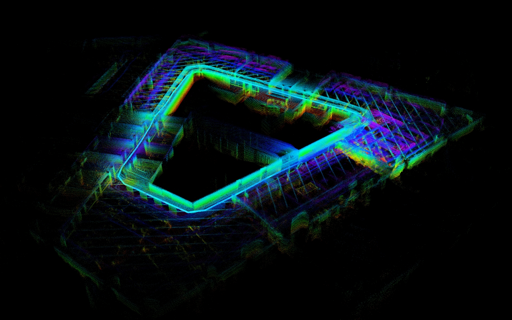

# FAST_LIO_Hesai

[](https://github.com/HesaiTechnology-Spatial-Perception/FAST_LIO_Hesai/actions/workflows/ci.yml)
[](LICENSE)

FAST_LIO_Hesai is Hesai's adaptation of
[FAST-LIO2](https://github.com/hku-mars/FAST_LIO) for JT-series and MT60
LiDARs. It consumes standard ROS point-cloud and IMU messages and publishes
real-time LiDAR-inertial odometry, registered point clouds, and an optional PCD
map.

> This README describes the **ROS 2 `ROS2` branch** (Ubuntu 22.04 + ROS 2
> Humble). For ROS 1 Melodic/Noetic, use the
> [`main`](https://github.com/HesaiTechnology-Spatial-Perception/FAST_LIO_Hesai/tree/main)
> branch.

FAST-LIO2 provides local odometry and mapping. This repository does **not**
include loop closure or global pose-graph optimization, so a returning path is
not guaranteed to overlap perfectly. The estimator is CPU-based; CUDA/GPU
acceleration is not included.

Input completeness now requires every synchronized frame to be accounted for as
startup or registration, with no skipped frames and coverage of the final scan.
`common.imu_max_gap` defaults to **0.05 s** throughout the run; exceeding it stops mapping.
Bag/PCAP entry points audit every selected message header timestamp before replay.
All-zero/repeated/backwards times fail explicitly; a verified PCAP clock translation can
be supplied with `--timestamp-offset SEC`. ROS1 PCAP conversion starts a local master
when needed and preserves existing masters. Live driver exits are reported as failures;
shutdown escalates INT → TERM → KILL within bounded grace periods.

## Driver and installed-package support

Use the [driver compatibility matrix](DRIVER_COMPATIBILITY.md) for the pinned public driver/SDK,
model/mode support, message units and evidence limits. JT32 requires a separately
obtained compatible driver for live/PCAP operation; MT60 needs a verified publisher
and is not registered for unified PCAP conversion. A model YAML is not a hardware
qualification. Do not apply a nonzero `--timestamp-offset` to the pinned public
driver: that driver does not implement the translation option.

Only the five Hesai model launches are distributed (ROS 2 also has the generic
`mapping.launch.py`). Unsupported legacy launches and the old Livox GDB example
have been removed. CI checks both source and installed catalogs, runs synthetic
bag replay and default 1 Hz saving through the installed entry, tests invalid
input and driver failure, and executes the actual-node regressions. ROS1 additionally
checks converter-owned and pre-existing masters with a synthetic driver. These
checks do not replace sensor/firmware qualification or real PCAP decoding tests.
ROS2 playback waits for stable DDS matching before resume; exact input counts and
registration coverage remain the acceptance criteria.

## Supported LiDARs

| Model | Config | Launch file | Live / bag | PCAP conversion | Notes |
| --- | --- | --- | --- | --- | --- |
| JT16 | `config/jt16.yaml` | `mapping_jt16.launch.py` | Included | Included | Public driver supported |
| JT32 | `config/jt32.yaml` | `mapping_jt32.launch.py` | Compatible driver or prepared bag | Compatible driver required | Pinned public driver does not parse JT32 UDP 1.12 |
| JT64P | `config/jt64p.yaml` | `mapping_jt64p.launch.py` | Included | Included | JT128-compatible 128-ring layout; use the device-matched 128-channel angle file |
| JT128 | `config/jt128.yaml` | `mapping_jt128.launch.py` | Included | Included | Monitor processing latency and dropped messages with dense scans |
| MT60 | `config/MT60.yaml` | `mapping_mt60.launch.py` | Compatible publisher or prepared bag | Not registered in the one-command converter | Select `mt60` explicitly during input checks |

“Included” means that this repository contains the corresponding parser,
configuration, and launch path. Mapping quality still depends on correct
calibration, timestamps, IMU units, extrinsics, mounting, motion, and scene
geometry.

JT64P and JT128 publish the same 128-ring PointCloud2 layout. Ring inspection
therefore cannot distinguish the two models; select `jt64p` explicitly and use
the JT64P device-matched 128-channel angle-correction file.

## Input and output

Default input topics:

| Data | Topic | Type | Required content |
| --- | --- | --- | --- |
| Point cloud | `/lidar_points` | `sensor_msgs/msg/PointCloud2` | `x`, `y`, `z`, `intensity`, `ring`, per-point `timestamp` |
| IMU | `/lidar_imu` | `sensor_msgs/msg/Imu` | Valid timestamps, angular velocity, linear acceleration |

Main outputs:

| Output | Topic / frame |
| --- | --- |
| Odometry | `/Odometry` |
| Path | `/path` |
| Registered scan | `/cloud_registered` |
| Accumulated map, when enabled | `/Laser_map` |
| Fixed frame in RViz | `camera_init` |

LiDAR and IMU timestamps must use the same clock. `preprocess.timestamp_unit`
must match the per-point timestamp field. Set `common.imu_gyr_unit` to `rad` or
`deg` when the publishing driver contract is known; `auto` is a compatibility
heuristic, not a substitute for verifying the driver output.

## Install (ROS 2 Humble)

Install ROS 2 Humble and the
[Hesai ROS Driver](https://github.com/HesaiTechnology/HesaiLidar_ROS_2.0)
first. Then build FAST_LIO_Hesai in a separate workspace:

```bash
source /opt/ros/humble/setup.bash

mkdir -p ~/fast_lio_ros2_ws/src
cd ~/fast_lio_ros2_ws/src
git clone --branch ROS2 --recurse-submodules \
  https://github.com/HesaiTechnology-Spatial-Perception/FAST_LIO_Hesai.git

cd ~/fast_lio_ros2_ws
rosdep install --from-paths src --ignore-src --rosdistro humble -r -y
colcon build --packages-select fast_lio \
  --cmake-args -DCMAKE_BUILD_TYPE=Release
source install/setup.bash
```

If the repository was cloned without submodules, run:

```bash
git submodule update --init --recursive
```

## Quick start

Run the unified helper from the repository root. Use `--dry-run` first when
workspace or calibration-file discovery is uncertain.

```bash
# Live LiDAR: start the driver, FAST-LIO2, and RViz
./tools/run_fastlio.sh jt128 live \
  --fastlio-ws ~/fast_lio_ros2_ws \
  --driver-ws ~/hesai_ros2_ws

# Existing rosbag2
./tools/run_fastlio.sh jt128 bag /data/jt128_bag \
  --fastlio-ws ~/fast_lio_ros2_ws

# PCAP -> rosbag2 -> FAST-LIO2
./tools/run_fastlio.sh jt128 pcap /data/JT128/input.pcap \
  --fastlio-ws ~/fast_lio_ros2_ws \
  --driver-ws ~/hesai_ros2_ws --correction /data/calibration/device.csv
```

Useful options:

```text
--play-rate RATE
--save-map [PATH]
--no-rviz
--dry-run
```

Run `./tools/run_fastlio.sh --help` for the complete interface. All modes preserve
the model YAML IMU unit unless `--imu-gyr-unit` overrides it; `auto` uses the
node startup heuristic. PCAP conversion requires explicit `--correction`.

### Manual launch

With a driver or rosbag already publishing the two input topics:

```bash
source /opt/ros/humble/setup.bash
source ~/fast_lio_ros2_ws/install/setup.bash
ros2 launch fast_lio mapping_jt128.launch.py rviz:=true
```

## Validate before mapping

Check the YAML without starting ROS:

```bash
python3 tools/check_config.py \
  --config config/jt128.yaml --model jt128 --ros 2
```

While the driver or bag is publishing, check the actual messages:

```bash
ros2 run fast_lio check_input.py --model jt128 --timestamp-unit 0
```

Resolve timestamp, field, ring, IMU-rate, and clock-sync failures before tuning
the estimator. Parameter tuning cannot repair malformed or dropped input.

## Map export and run validation

PCD export is opt-in (`--save-map`). Supplied model YAMLs default to a **sensor-time 1 Hz
accumulated map**. The estimator's `filter_size_surf` and `filter_size_map`
are independent of export resolution. The default 1 Hz export applies no
additional voxel filtering; `leaf_size` is used only by `voxel` and `all`.

```bash
# Default 1 Hz accumulated map in a new run directory
./tools/run_fastlio.sh jt128 bag /data/jt128_bag --save-map
# Three comparable exports from the same registered scans
./tools/run_fastlio.sh jt128 bag /data/jt128_bag --save-map --map-mode all
# Optional 0.1 m voxel map
./tools/run_fastlio.sh jt128 bag /data/jt128_bag --save-map --map-mode voxel
```

| `pcd_save.mode` / `--map-mode` | Output |
| --- | --- |
| `voxel` | Weighted centroids of all registered points; `leaf_size` / `--map-leaf-size` controls resolution |
| `raw` | All registered scans after preprocessing and IMU initialization; this is not the original sensor packet data |
| `1hz` | First registered scan in each one-second bucket, anchored at the first registered timestamp |
| `all` | Main voxel PCD plus sibling `_origin.pcd` and `_1hz.pcd` files |

Raw and 1 Hz records are spooled to private temporary files rather than retained
in RAM. Voxel accumulation preserves every observation's weight across frames
and repeated saves; its memory still grows with newly explored voxels. Raw
snapshots currently need disk space for both the spool and the published PCD.
All exports contain compact binary float32 XYZI records (16 bytes/point).

Each PCD is written to a temporary file beside its destination and atomically
renamed after a successful write. A failure leaves the previous snapshot intact
and returns an error. Atomicity is per file, not across the three-file set.
`pcd_save.interval: -1` saves on request/exit; a positive value checkpoints the
**whole accumulated map** every N registered scans without clearing it. A save
without new scans does not rewrite the files. `<map_file_path>.json` records
point counts, modes and sensor-time coverage. Saving/density changes do not
correct drift or add loop closure.

With no explicit path, output goes to a new
`~/slam_ws/src/slam_maps/fastlio_<model>_<run>/map.pcd` directory. Manual nodes
also allocate a unique default directory. Relative paths are resolved from the
process working directory; parent directories are created automatically.
Legacy YAMLs without `mode` retain `leaf_size=0` → raw and `leaf_size>0` → voxel.

The runner stores `run.json`, `effective.yaml`, process logs, `drain.json`,
`map_save.json`, `node_status.json` and `result.json` under `~/slam_ws/logs/fastlio_<model>_<run>/`
(or `--log-dir`). Metadata includes commit, branch and dirty-worktree state.
It waits for mapper readiness, uses a paused ROS 2 player until the mapper reports matched publishers,
checks exact LiDAR/IMU receipt counts and queue exhaustion, then checks the save
service response and PCD payload length. `--drain-timeout` and `--save-timeout`
default to 120 seconds. Missing messages or an IMU-uncovered tail are reported
as incomplete processing; a diagnostic partial map may still be saved.
**Processing completeness is not geometric accuracy.**
The node writes its own final exit result so ROS 1 launch wrappers cannot hide
a child failure. `common.log_dir` also holds enabled TUM trajectories and
diagnostic logs; the runner sets it to the run directory.

`/mapping_status` (`std_srvs/Trigger`) exposes counters and last timestamps.
ROS 2 `/Laser_map` is an optional 0.2 m voxel preview (`publish.map_leaf_size`),
updated from distinct sensor-time 1 Hz samples. Its publication timer does not
append the last scan again while input is paused. The preview, exported maps
and internal ikd-Tree map have different roles.

LiDAR/IMU header time rollback, repeated timestamps, or non-finite IMU
measurements stop the node with exit code 3. Start a new
mapping run after resetting a device clock or rewinding a bag; live estimator
state is not reused across timelines. ROS 2 live subscriptions default to Best Effort and accept both Best Effort
and Reliable publishers. The runner sets `common.reliable_input: true` and
a Reliable player QoS override for bag playback, then waits for actual matched
publishers before resuming. Manual Reliable subscriptions require Reliable
publishers; message-count verification remains necessary. Input-check FAIL results now return a
nonzero exit code; the short live checker is not a complete bag audit.

`config/` ships only the five standard model baselines: `jt16.yaml`, `jt32.yaml`,
`jt64p.yaml`, `jt128.yaml`, and `MT60.yaml`. Their LiDAR/IMU clock offsets are zero;
no recording-specific offset or startup delay is preset. These are model defaults,
not device calibration certificates. Verify IMU units and LiDAR/IMU extrinsics for
your device. Keep device- or recording-specific overrides outside the checkout and
select them explicitly with `--config /absolute/path/to/custom.yaml`. Saving remains
opt-in; the default export mode is sensor-time `1hz`.

## Documentation

- [English developer guide](https://hesaitechnology.github.io/dev/docs/how_to_guides/fast-lio2-hesai-jt-quickstart)
- [中文开发者指南](https://hesaitechnology.github.io/dev/zh/docs/how_to_guides/fast-lio2-hesai-jt-quickstart)
- [Tool reference](tools/README.md)
- [Changelog](CHANGELOG.md)
- [Contributing](CONTRIBUTING.md)
- [Security policy](SECURITY.md)
- [Release process](RELEASING.md)
- [Third-party notices](THIRD_PARTY_NOTICES.md)

Example JT16 mapping result:



## Troubleshooting

- **No point cloud in RViz:** set the fixed frame to `camera_init`; verify
  `/cloud_registered` and `/path`; then check ROS 2 QoS compatibility.
- **Map suddenly diverges:** inspect IMU units, LiDAR/IMU timestamps, per-point
  timestamp units, dropped messages, and extrinsics before changing filters.
- **The return path does not close:** some drift is expected because loop
  closure is not included. Large discontinuities still indicate an input,
  calibration, or initialization problem.
- **PCAP conversion fails:** pass the correct device angle-correction and
  firetime files explicitly and inspect the resulting bag with
  `ros2 bag info` plus `check_input.py`.

When opening an issue, include the LiDAR model, OS/ROS version, branch and
commit, Hesai driver/SDK version, input mode, effective YAML, `check_input.py`
output, `ros2 bag info` (for bag playback), and the complete text log.

## Acknowledgements and license

This project is derived from
[FAST_LIO](https://github.com/hku-mars/FAST_LIO) by the MARS Lab, HKU, and
retains contributions originating from LOAM, Livox, ikd-Tree, and IKFoM. See
[THIRD_PARTY_NOTICES.md](THIRD_PARTY_NOTICES.md) for attribution.

FAST_LIO_Hesai is distributed under the GNU General Public License v2.0. See
[LICENSE](LICENSE).
